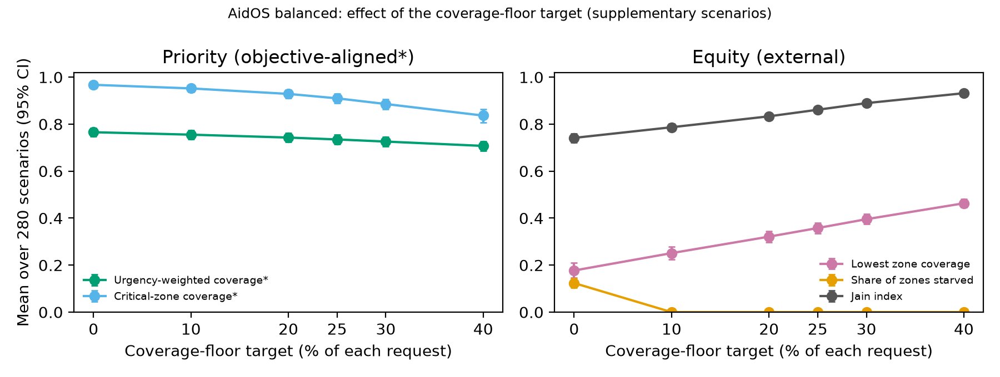
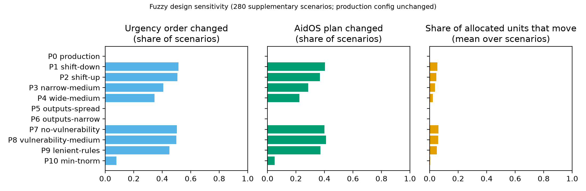
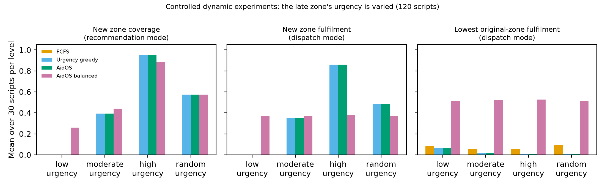
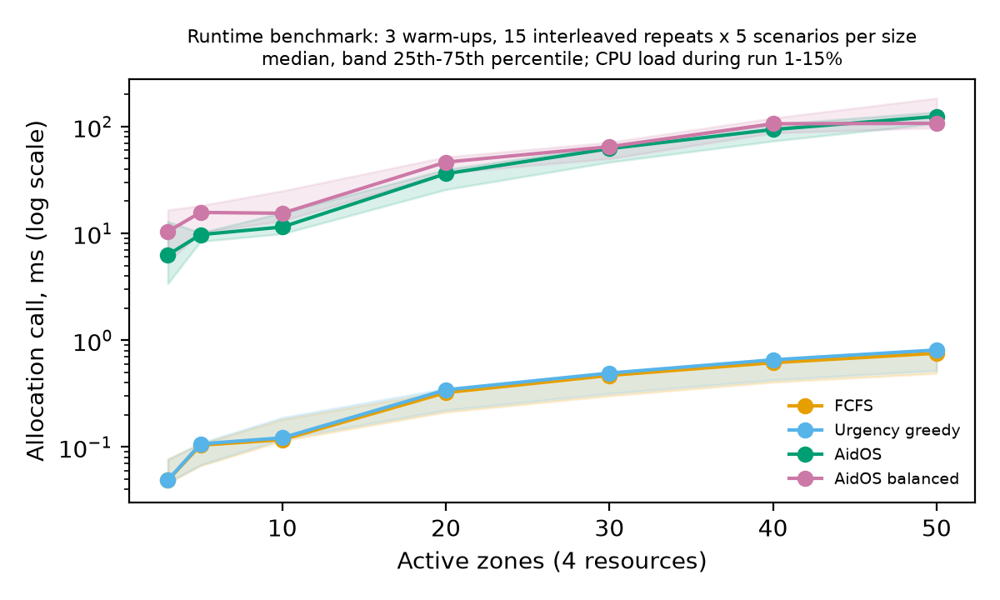

# Stage 5 supplementary experiments

These experiments are **supplementary and exploratory**. They answer questions raised by the Stage 4 review.

- **Data.** They use new seeds, outside the frozen benchmark, and every run writes its own `experiments/results/supplementary-*` directory with config, raw CSV, summary and a checksum manifest.
- **What was not changed.** The Stage 4 runs, the production fuzzy rules and the policy defaults are unchanged.
- **No hypothesis tests.** Effects are reported with bootstrap CIs, and nothing is selected by significance.

| Experiment | Script | Run directory |
|---|---|---|
| Greedy vs CP-SAT equivalence | `experiments/greedy_equivalence.py` | `supplementary-greedy-equivalence-20261112T164930Z` |
| Coverage-floor sweep | `experiments/floor_sweep.py` | `supplementary-floor-sweep-20261112T165054Z` |
| Fuzzy design sensitivity | `experiments/fuzzy_sensitivity.py` | `supplementary-fuzzy-sensitivity-20261112T165230Z` |
| Controlled dynamic scripts | `experiments/dynamic_controlled.py` | `supplementary-dynamic-controlled-20261112T165434Z` |
| Runtime benchmark | `experiments/runtime_benchmark.py` | `supplementary-runtime-benchmark-20261112T170741Z` |
| Independent audit of Stage 4 statistics | `experiments/audit_stage4.py` | `supplementary-stage4-audit-20261112T170734Z` |

Figures 9–12 are in [`figures/`](figures/). Everything was produced on the development laptop (Windows, Python 3.11.9, OR-Tools 9.15.6755).

## 1. Greedy vs CP-SAT

See [`../algorithms/greedy-vs-cpsat-analysis.md`](../algorithms/greedy-vs-cpsat-analysis.md). The agreement is proven and checked:

- 36,240 exhaustive small instances: greedy equals the unique brute-force optimum in every case, and CP-SAT equals greedy on all 907 sampled.
- 700 random scenarios with random resource weights and ε: 100% identical.
- A vehicle-capacity counterexample (a proposed extension) shows where an optimiser would matter.

## 2. Coverage-floor sweep (AidOS balanced)

- **Design.** 280 scenarios (families A–G, indices 1000–1039). Pre-declared targets: 0, 10, 20, 25, 30, 40% of each request. All 1,680 runs were valid and OPTIMAL.
- **What the floor means.** For each resource, CP-SAT maximises one common fraction f_r ≤ target such that every requesting zone gets at least ⌈f_r · d⌉ units, then allocates the rest by urgency. When the stock cannot give every requester the target, **f_r is reduced; the target is not guaranteed.**

| Target | Urgency-weighted coverage* | Critical-zone coverage* | Lowest zone coverage | Share starved | Jain | Resource cases where the floor was reduced | Plans identical to urgency-first |
|---|---|---|---|---|---|---|---|
| 0% | 0.766 | 0.967 | 0.177 | 0.124 | 0.741 | 0 / 1,003 | 280 / 280 |
| 10% | 0.755 | 0.952 | 0.251 | 0.000 | 0.787 | 0 / 1,003 | 30 / 280 |
| 20% | 0.743 | 0.929 | 0.321 | 0.000 | 0.833 | 0 / 1,003 | 26 / 280 |
| **25% (default)** | 0.735 | 0.910 | 0.358 | 0.000 | 0.861 | 5 / 1,003 | 24 / 280 |
| 30% | 0.726 | 0.886 | 0.395 | 0.000 | 0.889 | 37 / 1,003 | 24 / 280 |
| 40% | 0.707 | 0.836 | 0.463 | 0.000 | 0.932 | 136 / 1,003 | 22 / 280 |

Paired against 0% (95% bootstrap CI), each step costs urgency-weighted coverage and buys equity, monotonically:

| Target | Urgency-weighted coverage | Lowest zone coverage |
|---|---|---|
| 10% | −0.011 [−0.012, −0.009] | +0.074 [0.069, 0.079] |
| 25% | −0.031 [−0.035, −0.027] | +0.181 [0.170, 0.192] |
| 40% | −0.058 [−0.065, −0.052] | +0.286 [0.270, 0.302] |

Reading:

- **Starvation.** A 10% floor already removes starvation in every one of these scenarios.
- **The default.** 25% is a design choice inside a smooth trade-off, not an optimum; the data does not single it out.
- **The generator shapes the relaxation counts.** Its scarcest family gives 25–50% stock, so floors up to 25% are almost always feasible here. In scarcer real situations the reduction would happen more often.

## 3. Fuzzy design sensitivity

- **Design.** The same 280 scenarios. Ten pre-declared variants, built in memory; the production file was not changed.
- **Yardstick.** Urgency-weighted coverage is measured with the *production* scores, so plans are compared on a common scale.

| Variant | Monotonic dips | Order changed | AidOS plan changed | Units moved (mean share) | Kendall τ_b vs production | UWC* (production scores) | Lowest zone | Starved share |
|---|---|---|---|---|---|---|---|---|
| P0 production | 0 / 7,260 | 0 | 0 | 0.000 | 1.000 | 0.766 | 0.177 | 0.124 |
| P1 breakpoints −1 | 0 | 144 | 113 | 0.054 | 0.891 | 0.762 | 0.176 | 0.124 |
| P2 breakpoints +1 | 0 | 142 | 103 | 0.047 | 0.895 | 0.762 | 0.177 | 0.125 |
| P3 narrow medium | 0 | 114 | 80 | 0.037 | 0.938 | 0.763 | 0.179 | 0.125 |
| P4 wide medium | 0 | 97 | 63 | 0.023 | 0.940 | 0.765 | 0.176 | 0.127 |
| P5 outputs 0/33/67/100 | 0 | **0** | **0** | 0.000 | 1.000 | 0.766 | 0.177 | 0.124 |
| P6 outputs 20/40/60/80 | 0 | **0** | **0** | 0.000 | 1.000 | 0.766 | 0.177 | 0.124 |
| P7 vulnerability ignored | 0 | 141 | 112 | 0.062 | 0.833 | 0.755 | 0.178 | 0.129 |
| P8 medium vulnerability also raises | 0 | 140 | 115 | 0.061 | 0.860 | 0.759 | 0.179 | 0.122 |
| P9 lenient rule mapping | 0 | 126 | 104 | 0.051 | 0.884 | 0.760 | 0.179 | 0.120 |
| P10 min t-norm | **132** | 22 | 14 | 0.004 | 0.986 | 0.766 | 0.177 | 0.122 |

Counts are out of 280 scenarios.

Reading:

- **Only the order of the scores matters.** Changing the rule-output values (P5, P6) changes nothing, because the scores keep their order and AidOS (like greedy) depends only on that order.
- **Ordering is sensitive.** Moving the membership breakpoints by one rating point, or changing how vulnerability enters, reorders zones in 35–51% of scenarios and changes the plan in 22–41%. Only 2–6% of allocated units move, and the external equity metrics are essentially unchanged.
- **The ordering is a modelling assumption.** It is not a validated measure of need, and it is the main source of uncertainty in "who gets served".
- **Monotonicity depends on the product t-norm.** Every product-Sugeno variant stayed monotone. The min-t-norm variant did not (132 dips in 7,260 steps), which supports the Stage 2 choice of product.

## 4. Controlled dynamic scripts

**The Stage 4 bias.** Every Stage 4 script added a *highly urgent* zone that arrives last, a case FCFS can never serve.

**Design here.**
- The new zone's ratings are drawn from low (0–3), moderate (4–6), high (7–10) or random (0–10), independently of its (last) arrival.
- These levels are crossed with 3, 5 or 8 initial zones, and 10 seeds per cell: **120 scripts**.
- **Recommendation mode** (shared state): escalation, new zone, 25% supply loss, shipment, request increase. All policies see the same state at every step.
- **Dispatch mode** (own trajectories): stock starts at 30%, with three 15% waves and four dispatches. The same exogenous script goes to every policy (verified by hash), and each policy's state then evolves from its own dispatches.

**Integrity (480 dispatch runs):**
- inventory conserved 480/480;
- double dispatch blocked 480/480;
- identical exogenous scripts for all policies;
- 0 rejected events;
- 2,400 of 2,400 recommendation-mode plans valid.

| New-zone urgency | New-zone coverage, recommendation (FCFS / AidOS / balanced) | New-zone fulfilment, dispatch (FCFS / AidOS / balanced) | Lowest original-zone fulfilment, dispatch (FCFS / AidOS / balanced) | Original zones never served per script (FCFS / AidOS / balanced) |
|---|---|---|---|---|
| low | 0.00 / 0.00 / 0.26 | 0.00 / 0.00 / 0.37 | 0.080 / 0.063 / 0.514 | 0.60 / 0.67 / 0.00 |
| moderate | 0.00 / 0.39 / 0.44 | 0.00 / 0.35 / 0.37 | 0.054 / 0.017 / 0.521 | 0.60 / 1.10 / 0.00 |
| high | 0.00 / 0.95 / 0.89 | 0.00 / 0.86 / 0.38 | 0.057 / 0.010 / 0.527 | 0.70 / 1.37 / 0.00 |
| random | 0.00 / 0.57 / 0.57 | 0.00 / 0.48 / 0.37 | 0.093 / 0.004 / 0.516 | 0.53 / 1.20 / 0.00 |

Paired by script, AidOS − FCFS, dispatch mode, lowest original-zone fulfilment (95% CI):

| New-zone urgency | Difference |
|---|---|
| low | −0.017 [−0.044, 0.008] |
| moderate | −0.037 [−0.066, −0.009] |
| high | −0.048 [−0.077, −0.022] |
| random | −0.088 [−0.135, −0.048] |

Reading:

- **FCFS never serves a late zone, whatever its urgency.** AidOS serves it in proportion to the fuzzy model's urgency: almost never when it is low, almost always when it is high.
- **The cost to the original zones.** The units AidOS gives the newcomer come from the original zones. In every condition AidOS leaves the worst-off original zone at or below FCFS's level, and leaves more original zones with nothing.
- **The Stage 4 claim does not survive.** The "AidOS is fairer in dynamic crises" impression in Stage 4 came entirely from always making the newcomer urgent.
- **AidOS balanced** serves every zone, including the newcomer at any urgency. Its new-zone fulfilment is about 0.37 regardless of level, because the floor and the remaining stock are shared.
- **Responsiveness.** After an escalation, the urgency-based policies changed their plan in 33–53% of scripts (depending on level and policy); FCFS never did.

## 5. Runtime benchmark

**Protocol.**
- **Scenarios:** moderate scarcity, 4 resources, sizes 3–50 zones (50 is the validation limit), 5 scenarios per size.
- **Timing:** 3 warm-up runs, then 15 timed repeats per policy, interleaved round-robin, giving 75 timings per policy and size.
- **Conditions:** sampled CPU load during the run was 1–15%, a lightly loaded laptop rather than an isolated benchmark machine.
- **Status:** every CP-SAT run was OPTIMAL and every plan valid.

| Zones | FCFS median [p25, p75] | Greedy median | AidOS median [p25, p75] | AidOS balanced median | AidOS / greedy |
|---|---|---|---|---|---|
| 3 | 0.05 ms [0.05, 0.08] | 0.05 ms | 6.3 ms [3.4, 12.9] | 10.4 ms | 128× |
| 10 | 0.12 ms | 0.12 ms | 11.5 ms [9.9, 15.6] | 15.4 ms | 94× |
| 50 | 0.75 ms | 0.81 ms | 124 ms [107, 137] | 107 ms | 153× |

- **Where the time goes.** CP-SAT's own solve time is about 62–78% of the AidOS call. The rest is Python model construction and explanation building.
- **End to end.** Including validation and metrics, the median is at most 2.6 ms for the heuristics and 126 ms for AidOS at 50 zones.
- **Comparison with Stage 4.** These supersede the Stage 4 scaling figures *for reporting absolute times* (Stage 4 measured 334 ms at 50 zones under heavier background load). The Stage 4 numbers remain in their run directory, unchanged.
- **Worst case.** The largest input the API accepts (50 zones × 10 resources at the 1,000,000-unit cap) solved validly in a separate check, but balanced mode took about 2.6 s of its 5 s limit.

## 6. Independent audit of the Stage 4 statistics

`audit_stage4.py` recomputes the Stage 4 numbers with pandas and a hand-written sign test, a code path separate from `aidos.evaluation.stats`. **21 of 21 checks passed:**

- counts and seeds;
- metric denominators (unit coverage, starved share);
- bounds;
- every policy mean (max absolute difference 0);
- every paired AidOS − FCFS difference, effect size, and CI containment;
- sign tests and Holm adjustments;
- AidOS = greedy in all 504 scenarios;
- script-level (n = 60) dynamic aggregation;
- the empty failure log;
- figures byte-identical between the run and `docs/evaluation/figures/`;
- the generated tables traceable to the run.

The dashboard reads the same `summary.json` through the API, and the Stage 5 frontend audit confirmed the displayed values match it.

## What changes in the conclusions

1. **CP-SAT vs greedy** is now a proven result, not an observation.
2. **The dynamic equity claim from Stage 4 is withdrawn.** Urgency-first allocation redistributes towards whatever the urgency model rates highly, including late arrivals, at the expense of the worst-off original zones.
3. **The equity–priority trade-off is controlled by the floor.** It is smooth and monotonic, and 10% already removes starvation in these scenarios.
4. **Allocations depend only on the order of the urgency scores.** That order is sensitive to modelling choices that have not been validated.
5. **Runtime claims** should use section 5: about 6–125 ms for AidOS versus under 1 ms for the heuristics, on a lightly loaded laptop.
